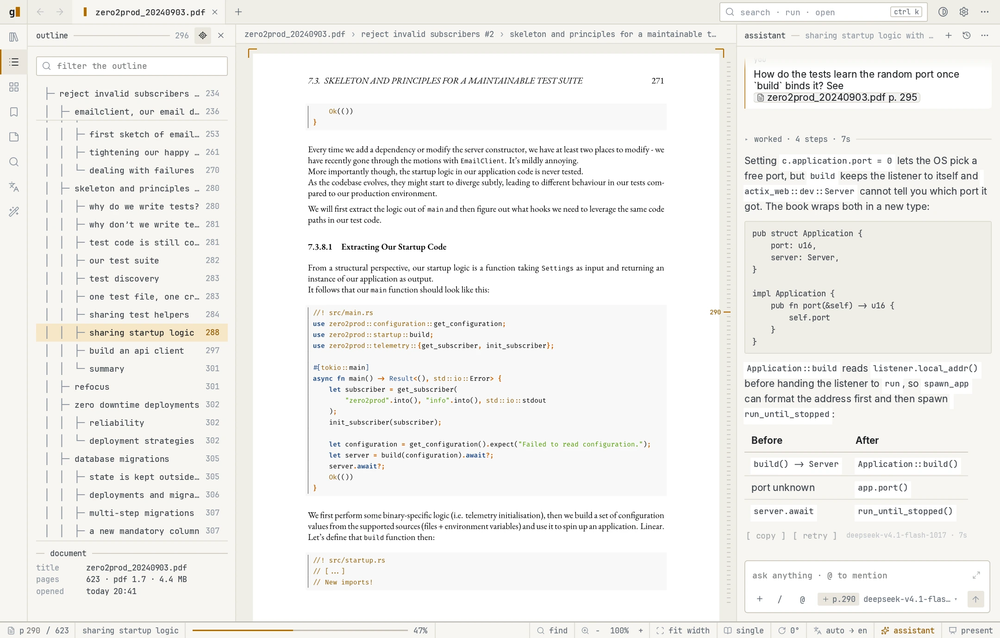
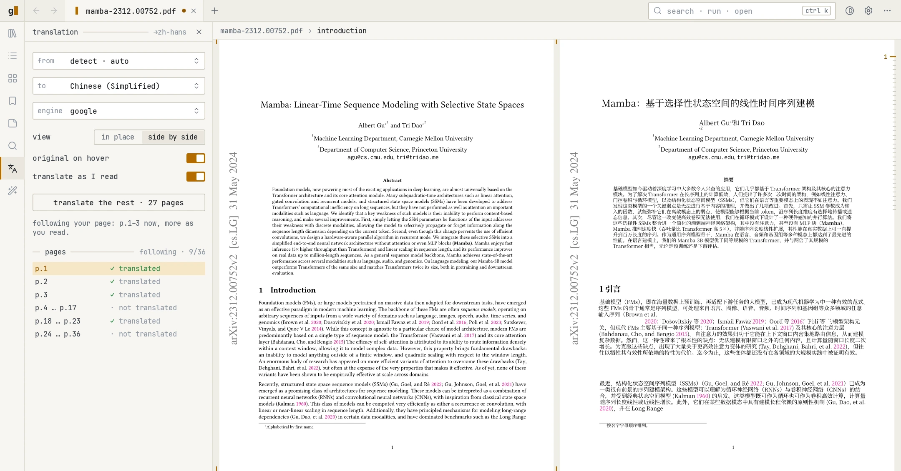
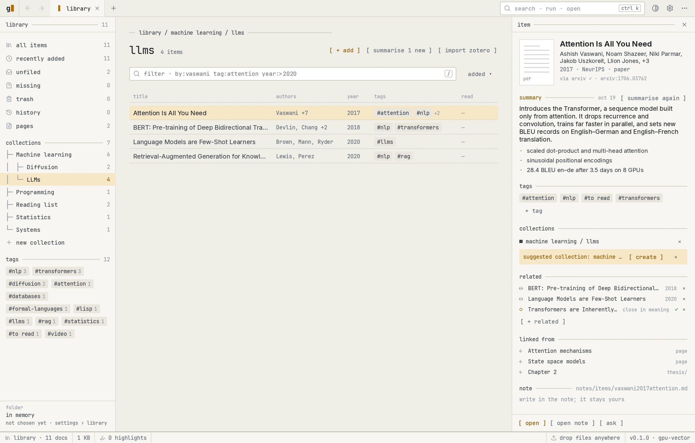

<p align="center">
  
</p>

<h1 align="center">Glyphst Reader</h1>

<p align="center">
  A PDF and EPUB reader that draws every page from its vectors on the GPU.<br>
  Zoom glides and text stays sharp; translation, an assistant and a library
  that files itself are one keystroke away.
</p>

<p align="center">
  <a href="https://github.com/glyphst/glyphst/releases/latest"></a>
  <a href="https://github.com/glyphst/glyphst/actions/workflows/ci.yml"></a>
  <a href="LICENSE"></a>
</p>

<p align="center">
  <a href="https://glyphst.com/reader/"><b>Website</b></a> ·
  <a href="https://github.com/glyphst/glyphst/releases/latest"><b>Download</b></a> ·
  <a href="#getting-started"><b>Getting started</b></a> ·
  <a href="CONTRIBUTING.md"><b>Contributing</b></a>
</p>

<picture>
  <source media="(prefers-color-scheme: dark)" srcset="docs/images/dark-hero.webp">
  
</picture>

## Features

- **Sharp at any zoom.** Pages are drawn from their vectors on the GPU, so
  text and line art stay crisp however far you zoom, and zooming glides.
- **Translation that keeps the layout.** Translate a whole document, the pages
  as you read them, or a selection. The translation is set into the page in
  place, or shown side by side with the original; hover a block to see its
  partner. Uses DeepL, Google or Microsoft Translator.
- **An assistant that reads along.** Ask about the page, a selection or a
  figure, and get answers that cite their pages. Bring your own model
  (OpenAI, Anthropic, DeepSeek or any compatible API) or agent (Claude Code,
  Codex, Pi or any ACP agent).
- **A library that files itself.** Folders, collections and tags, search by
  words or by meaning across every document, and suggested collections and
  related papers. The library lives on your computer.
- **Made for long reads.** Tabs and split panes, a ctrl+tab book switcher,
  outline, bookmarks, highlights and notes, two-page spreads, rotation, a page
  overview and back and forward through links.
- **Present from it.** Full screen with a pen, highlighter, laser and timer.
- **Read from the couch.** A gamepad mode with its own home and a reading ring
  on the right stick.
- **Make it yours.** Themes from your wallpaper, page tints, shader effects
  for page turns and backgrounds, a transparent window, and every shortcut
  configurable, with a Vim keymap.

<table>
  <tr>
    <td width="50%">
      <picture>
        <source media="(prefers-color-scheme: dark)" srcset="docs/images/dark-side-by-side.webp">
        
      </picture>
      <p align="center"><sub>Translation, side by side</sub></p>
    </td>
    <td width="50%">
      <picture>
        <source media="(prefers-color-scheme: dark)" srcset="docs/images/dark-library.webp">
        
      </picture>
      <p align="center"><sub>The library</sub></p>
    </td>
  </tr>
</table>

## Download

Get the executable for your computer from the
[latest release](https://github.com/glyphst/glyphst/releases/latest). Each is a
single file; there is nothing to install.

| System | File |
| --- | --- |
| Linux, x86_64 | `glyphst-reader-<version>-linux-x86_64` |
| Linux, ARM64 | `glyphst-reader-<version>-linux-aarch64` |
| macOS 11 or newer, Apple silicon | `glyphst-reader-<version>-macos-aarch64` |
| Windows 10 or newer, x64 | `glyphst-reader-<version>-windows-x86_64.exe` |
| Windows 10 or newer, ARM64 | `glyphst-reader-<version>-windows-aarch64.exe` |

`SHA256SUMS` in each release lists the files' checksums.

<details>
<summary><b>Linux</b></summary>

The executable runs on distributions with glibc 2.31 or newer (Ubuntu 20.04,
Debian 11, Fedora 32 and later) and needs a Vulkan or OpenGL driver. Make it
executable, then run it:

```sh
chmod +x glyphst-reader-*-linux-x86_64
./glyphst-reader-*-linux-x86_64 paper.pdf
```

With Nix: `nix run github:glyphst/glyphst -- paper.pdf`.
</details>

<details>
<summary><b>macOS</b></summary>

The executable is not signed yet, so macOS stops it the first time. Remove the
quarantine mark once, then run it:

```sh
xattr -d com.apple.quarantine glyphst-reader-*-macos-aarch64
chmod +x glyphst-reader-*-macos-aarch64
./glyphst-reader-*-macos-aarch64 paper.pdf
```
</details>

<details>
<summary><b>Windows</b></summary>

The executable is not signed yet, so SmartScreen may warn about it: choose
**More info**, then **Run anyway**. You can also open a document by dropping it
on the executable.
</details>

## Getting started

Open a document with **Ctrl+O**, by passing its path to the executable, or from
the library on the home screen. A few keys to start with (**Ctrl** is **⌘** on
macOS):

| Key | Does |
| --- | --- |
| **Ctrl+K** | Command palette: every command, searchable |
| **Ctrl+F** | Find in the document |
| **Ctrl+T** | Translate the selection |
| **Ctrl+L** | Open the assistant |
| **Ctrl+Tab** | Switch between open books |
| **+ / − / 0** | Zoom in, zoom out, fit width |
| **Z** | Zen mode: only the page |
| **P** | Present |
| **Ctrl+,** | Settings |

Settings › Keyboard shortcuts lists and changes every key, and "Keys: Vim" in
the palette switches to the Vim keymap.

Translation and the assistant need a provider: add your key in Settings ›
Translation or Settings › AI. Fonts for translating into Chinese, Japanese or
Korean, and the models for local search and OCR, download when first needed;
Settings › Resources shows and manages them.

## Contributing

Bug reports and ideas are welcome in
[issues](https://github.com/glyphst/glyphst/issues). To build from source, run
the checks or cut a release, see [CONTRIBUTING.md](CONTRIBUTING.md); the
[architecture notes](ARCHITECTURE.md) explain how the pieces fit.

## Acknowledgements

Glyphst Reader is built on [MuPDF](https://mupdf.com) (through
[mupdf-rs](https://github.com/messense/mupdf-rs)),
[egui](https://github.com/emilk/egui), [wgpu](https://wgpu.rs) and
[Typst](https://typst.app), with icons from [Lucide](https://lucide.dev). It
also owes a great deal to projects we studied closely:

- [Highly-Efficient-PDF-Renderer](https://github.com/soadzoor/Highly-Efficient-PDF-Renderer):
  the model for drawing pages on the GPU and for smooth, sharp zoom.
- [retain-pdf](https://github.com/wxyhgk/retain-pdf): the layout-preserving
  approach behind translation.
- [Zed](https://github.com/zed-industries/zed): the Reader began on its GPUI;
  Mermaid diagrams are adapted from its `mermaid_render`, and the release
  builds and fonts follow its lead.
- [sioyek](https://github.com/ahrm/sioyek) and
  [zathura](https://github.com/pwmt/zathura): the reading keys and the Vim
  keymap.
- [Zeron](https://github.com/zeronsh/zeron): the assistant's chat, its small
  motions and Markdown tables.
- [niri](https://github.com/YaLTeR/niri): following the desktop's theme and
  blur.

## License

Glyphst Reader is free software under the
[GNU Affero General Public License v3.0](LICENSE). The bundled fonts and icons
keep their own licences, kept beside them in `crates/ui/assets` and
`crates/pdf-translation/fonts`.

The screenshots show *Mamba: Linear-Time Sequence Modeling with Selective
State Spaces* (Albert Gu and Tri Dao,
[CC BY 4.0](https://creativecommons.org/licenses/by/4.0/)) and *Zero To
Production in Rust* (Luca Palmieri).
